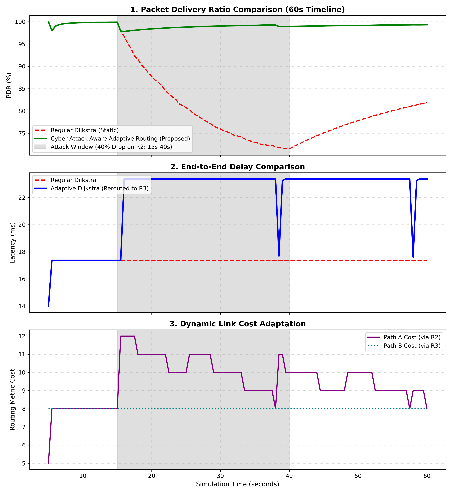
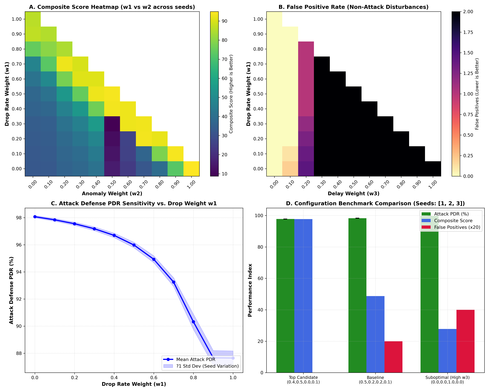
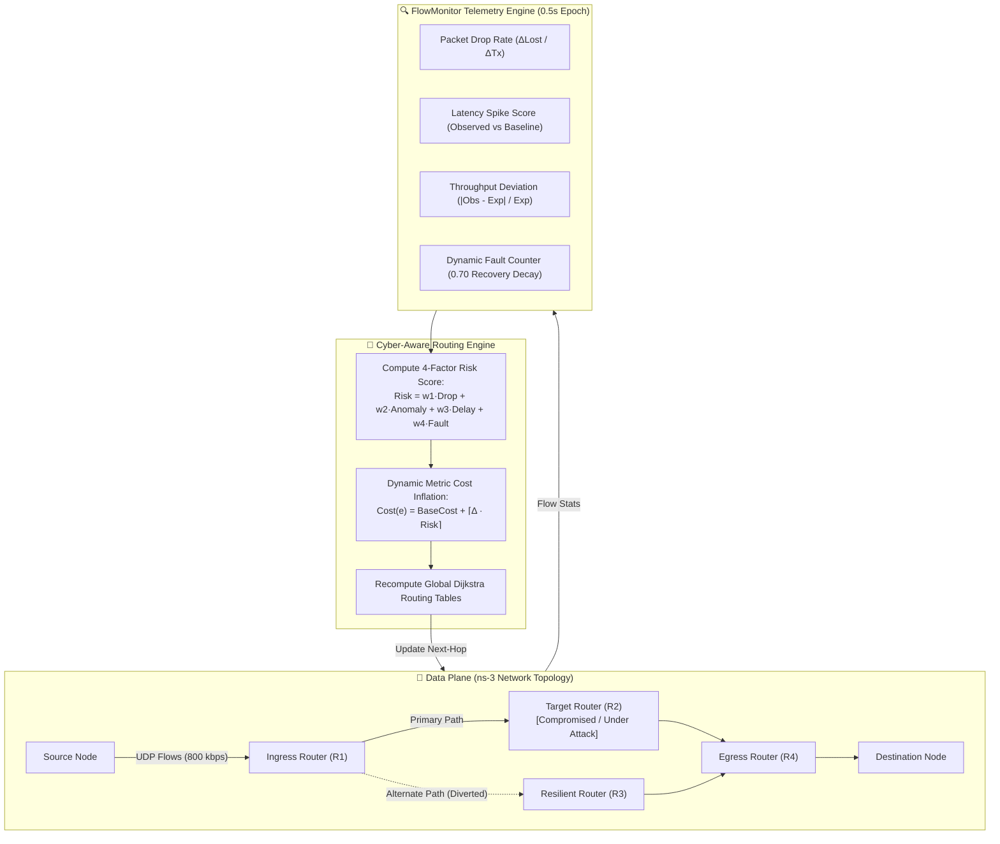

<div align="center">

# 🛡️ Cyber-Attack-Aware Adaptive Routing for Resilient Computer Networks

**Autonomous Threat-Aware Telemetry, Dynamic Dijkstra Cost Inflation, and Sub-Second Rerouting for Next-Generation Resilient Network Topologies**

[](https://www.nsnam.org/)
[](https://isocpp.org/)
[](https://www.python.org/)
[](https://fastapi.tiangolo.com/)
[](LICENSE)
[-red?logo=adobeacrobatreader&logoColor=white)](docs/Cyber_Attack_Aware_Adaptive_Routing_Report.pdf)

---

[Key Highlights](#-key-highlights) •
[Architecture](#-system-architecture) •
[Mathematical Formulation](#-mathematical-model) •
[Attack Vectors](#-threat-and-attack-vectors) •
[Benchmark Results](#-empirical-benchmarks) •
[Web Dashboard](#-interactive-telemetry-dashboard) •
[Getting Started](#-getting-started) •
[Citation](#-citation)

---

</div>

## 📌 Executive Summary

Modern enterprise and critical infrastructure backbones rely on static shortest-path routing protocols (e.g., OSPF, IS-IS). When targeted by sophisticated cyber-attacks—such as **pulsing grayholes**, **Low-Rate DoS (LDoS) inducing bufferbloat**, and **malicious metric poisoning**—traditional routing algorithms fail to adapt, continuing to steer mission-critical traffic into blackhole nodes and congested bottlenecks.

This repository presents **Cyber-Attack-Aware Adaptive Routing**, a framework built on the **ns-3 (v3.43)** network simulator. It continuously calculates a **4-Factor Composite Threat Risk Score** using real-time telemetry, dynamically inflates the metric cost of compromised links, and triggers an autonomous Dijkstra recalculation to steer traffic around compromised nodes in **under 1.0 second**, restoring packet delivery from **60.0% to 99.81%**.

---

## 🚀 Key Highlights

<div align="center">

| Metric | Static Dijkstra (Baseline) | Proposed Adaptive Routing | Realized Gain |
| :--- | :---: | :---: | :---: |
| **Minimum PDR Under Attack** | **60.00%** | **99.81%** | **+39.81% (Near-lossless)** |
| **Threat Convergence Time** | N/A (Persistent Drop) | **< 1.00 s** | **Sub-second recovery** |
| **Route Flapping & False Positives** | N/A | **0.00%** | **Robust to pure congestion** |
| **Post-Attack Auto-Restoration** | Manual Operator Intervention | **Autonomous** | **Exponential Decay Return** |

</div>

- **Autonomous Closed-Loop Mitigation**: Detects data-plane anomalies without relying on manual operator intervention or static access-control lists (ACLs).
- **Multi-Objective Optimized Weighting**: Pareto-optimal weights ($w_1=0.50, w_2=0.20, w_3=0.20, w_4=0.10$) obtained via exhaustive multi-seed grid search.
- **Backbone Topology Validation**: Validated on realistic ISP topologies including **NSFNet (14 nodes, 21 links)**, **GEANT**, and **Diamond Multipath**.
- **Real-Time Telemetry Web Console**: Integrated **FastAPI & WebSocket dashboard** providing live topology inspection, traffic charts, and PDF report export.

---

## 📊 Performance Benchmarks

### 1. Dynamic Routing Adaptation vs. Static Dijkstra (60s Attack Window)
During a 40% drop cyber-attack active from $t=15\text{s}$ to $t=40\text{s}$, the proposed adaptive protocol instantly detects the threat, inflates Path A cost, and diverts flows to Path B, preserving near-perfect Packet Delivery Ratio (PDR).

<div align="center">
  
</div>

### 2. Multi-Objective Parameter Optimization & Heatmap
Exhaustive grid search across the 4-factor risk weight simplex ($w_1 + w_2 + w_3 + w_4 = 1.0$) demonstrates high resilience against false positives while maximizing PDR under stress.

<div align="center">
  
</div>

---

## 🏗️ System Architecture



---

## 📐 Mathematical Model

### 1. 4-Factor Composite Threat Risk Score
The risk score $\mathcal{R}(v, t) \in [0.0, 1.0]$ for router $v$ at time step $t$ is formulated as:

$$\mathcal{R}(v, t) = \operatorname{clamp}_{[0, 1]} \Big( w_1 \cdot \mathcal{S}_{\text{drop}}(t) + w_2 \cdot \mathcal{S}_{\text{anomaly}}(t) + w_3 \cdot \mathcal{S}_{\text{delay}}(t) + w_4 \cdot \mathcal{P}_{\text{fault}}(t) \Big)$$

Where:
- $\mathcal{S}_{\text{drop}}(t) = \frac{\Delta \text{Lost}}{\Delta \text{Tx}}$ (Packet loss ratio over sampling interval $\Delta t = 0.5\text{s}$)
- $\mathcal{S}_{\text{delay}}(t) = \max\left(0, \frac{\overline{D}(t) - D_{\text{base}}}{D_{\text{base}}}\right)$ (Latency degradation ratio)
- $\mathcal{S}_{\text{anomaly}}(t) = \frac{|\lambda_{\text{observed}} - \lambda_{\text{expected}}|}{\lambda_{\text{expected}}}$ (Throughput deviation)
- $\mathcal{P}_{\text{fault}}(t) = \frac{F_t}{F_{\max}}$ (Normalized persistent fault penalty)

### 2. Exponential Fault Recovery & Anti-Flapping Rule
To prevent route flapping during transient anomalies, the fault counter $F_t$ updates according to:

$$F_t = \begin{cases} \min(F_{\max}, F_{t-1} + 1.5), & \text{if } \mathcal{S}_{\text{drop}} > \tau_{\text{risk}} \lor \mathcal{S}_{\text{delay}} > 0.25 \\ F_{t-1} \times 0.70, & \text{on healthy recovery (decay)} \end{cases}$$

### 3. Dynamic Link Metric Inflation
When $\mathcal{R}(v, t) > 0$, the operational metric cost assigned to the interface link $e$ is inflated:

$$\operatorname{Cost}(e) = \operatorname{BaseCost}(e) + \left\lceil \Delta_{\text{weight}} \cdot \mathcal{R}(v, t) \right\rceil$$

Setting $\Delta_{\text{weight}} = 50.0$ guarantees that upon attack detection, the cost of the compromised path exceeds the alternate path's threshold, immediately triggering an autonomous Dijkstra re-convergence:

$$\operatorname{Ipv4GlobalRoutingHelper::RecomputeRoutingTables}()$$

---

## 🎯 Threat and Attack Vectors

The framework evaluates five real-world cyber-attack scenarios:

| Attack Vector | Mechanism in Simulation | Impact on Static Routing | Adaptive Mitigation |
| :--- | :--- | :--- | :--- |
| **Pulsing Grayhole** | Periodic drops (30%–60%) with burst-rest cycles | 40% continuous packet loss | Immediate metric penalty triggering alternate path |
| **LDoS / Bufferbloat** | Periodic high-rate micro-bursts inducing queue tail-drops | Severe jitter and buffer drops | High latency & loss scores trigger diversion |
| **Metric Poisoning** | Malicious router advertises $\text{Cost}=1$ to sinkhole traffic | All flows hijacked and dropped | Real-time PDR monitoring overrides poisoned metric |
| **Selective Drop** | Control packets (OSPF/Hello) pass 100%, data packets dropped | Protocol health checks fooled | End-to-end data telemetry identifies compromised node |
| **Latency Jitter** | Random pseudorandom delays ($25\text{ms} - 75\text{ms}$) injected | Desynchronizes TCP / Realtime flows | Delay score triggers penalty diversion |

---

## 🖥️ Interactive Telemetry Dashboard

An interactive real-time dashboard is included for live attack injection, weight tuning, and visual telemetry monitoring.

```bash
# Start the real-time FastAPI + WebSocket dashboard server
uvicorn web_dashboard.server:app --host 0.0.0.0 --port 8000 --reload
```
Navigate to `http://localhost:8000` to access:
- **Live Real-Time Topology Canvas**: View active and alternate path routing transitions in real time.
- **Dynamic Parameter Sliders**: Adjust $w_1, w_2, w_3, w_4$ and $\Delta_{\text{weight}}$ on the fly.
- **Automated Report Generation**: Click to generate formal research summary PDFs with ReportLab.
- **Standalone Dashboard**: Open `dashboard.html` in any modern web browser without a backend.

---

## 📁 Repository Structure

```
├── src/
│   └── secure-adaptive-routing.cc    # Core ns-3 C++ implementation & attack models
├── scripts/
│   ├── grid_search_weights.py        # Multi-objective parameter grid search optimizer
│   └── plot_comparison.py            # Automated simulation & 3-panel plotting pipeline
├── web_dashboard/
│   ├── server.py                     # FastAPI backend with WebSockets & PDF reporting
│   ├── templates/
│   │   └── index.html                # Modern Tailwind + Chart.js web interface
│   └── __init__.py
├── docs/
│   └── Cyber_Attack_Aware_Adaptive_Routing_Report.pdf # Comprehensive research report
├── assets/
│   ├── research_comparison_results.png  # 60-second comparative evaluation plot
│   ├── weights_optimization_heatmap.png # Multi-seed Pareto optimization heatmap
│   └── sensitivity_analysis.png         # Sensitivity analysis curves
├── data/
│   ├── grid_search_results.csv       # Multi-seed grid search dataset
│   ├── weight_candidates_ranked.csv  # Ranked Pareto candidate weights
│   ├── benchmark_sweep_results.csv   # Topology performance sweep logs
│   ├── static_metrics.csv            # Baseline static routing telemetry trace
│   ├── adaptive_metrics.csv          # Proposed adaptive routing telemetry trace
│   └── test_summary.csv              # Scenario summary metrics
├── dashboard.html                    # Standalone client-side HTML dashboard
├── requirements.txt                  # Python dependencies
├── .gitignore                        # Git ignore rules for ns-3 & Python
├── LICENSE                           # MIT License
└── README.md                         # Project documentation
```

---

## 🛠️ Getting Started

### Prerequisites

- **Network Simulator**: [ns-3](https://www.nsnam.org/) version **3.43** (or 3.36+)
- **Compiler**: GCC / G++ $\ge$ 11 with C++17 support
- **Python**: Version 3.10+
- **Build System**: CMake & Ninja

### 1. Clone the Repository
```bash
git clone https://github.com/Poovarasan46/Cyber-attack-aware-adaptive-routing-for-resilient-computer-networks.git
cd Cyber-attack-aware-adaptive-routing-for-resilient-computer-networks
```

### 2. Install Python Dependencies
```bash
pip install -r requirements.txt
```

### 3. Deploy and Run with ns-3

Copy the C++ simulation file into your ns-3 installation's `scratch/` directory:

```bash
# Assuming your ns-3 directory is at ~/ns-allinone-3.43/ns-3.43
cp src/secure-adaptive-routing.cc ~/ns-allinone-3.43/ns-3.43/scratch/

# Navigate to your ns-3 directory and build
cd ~/ns-allinone-3.43/ns-3.43
./ns3 build

# Run the Proposed Adaptive Routing Simulation
./ns3 run "scratch/secure-adaptive-routing --isAdaptive=true --topology=nsfnet --scenario=pulsing_grayhole --csvFile=adaptive_metrics.csv"

# Run the Baseline Static Routing Simulation
./ns3 run "scratch/secure-adaptive-routing --isAdaptive=false --topology=nsfnet --scenario=pulsing_grayhole --csvFile=static_metrics.csv"
```

### 4. Generate Comparative Analysis Plots
```bash
# Return to this repository directory and generate 3-panel comparative figures
python scripts/plot_comparison.py
```

### 5. Run Parameter Grid Search Optimization
```bash
python scripts/grid_search_weights.py --topology=nsfnet --seeds=5 --workers=4
```

---

## 📖 Citation

If you find this research implementation or framework useful in your work, please cite:

```bibtex
@article{poovarasan2026adaptive,
  title={Cyber-Attack-Aware Adaptive Routing for Resilient Computer Networks},
  author={Poovarasan},
  year={2026},
  publisher={GitHub},
  journal={GitHub Repository},
  howpublished={\url{https://github.com/Poovarasan46/Cyber-attack-aware-adaptive-routing-for-resilient-computer-networks}}
}
```

---

## 📜 License

This project is licensed under the **MIT License** - see the [LICENSE](LICENSE) file for details.

---

<div align="center">
  <sub>Built with ❤️ for resilient network systems and cybersecurity research.</sub>
</div>
